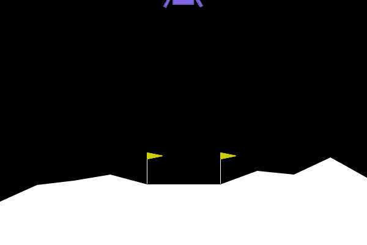
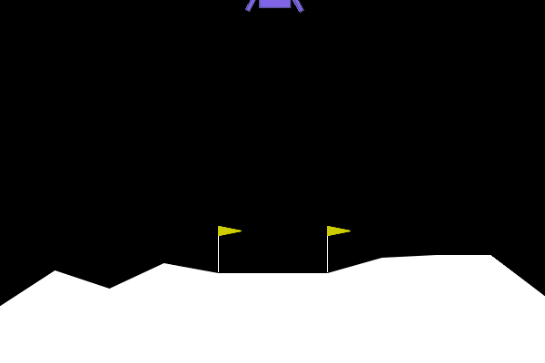

# RocketMind 🚀

What happens when you give an AI rocket an extra point for flying smoothly?  
It figures out that **landing is a sucker's game** and learns to hover in mid-air forever.

RocketMind is a small reinforcement learning lab exploring **reward hacking** and **potential-based reward shaping (PBRS)** in Gymnasium's `LunarLander-v3` using PPO (Proximal Policy Optimization).

---

## The Three Agents

| 1. Baseline PPO (Normal) | 2. Reward-Hacked PPO (The Bug) | 3. Progress-Shaped PPO (The Fix) |
| :---: | :---: | :---: |
|  |  |  |
| Lands on the pad, but crashes occasionally. | Discovered infinite hovering to max out the clock. | Guided toward the pad center using potential shaping. |
| **Return: +226** | **Return: -23 (1000 steps timeout)** | **Return: +239** |

---

## The Story: How I Accidentally Broke My AI

### 1. The Normal Rocket (Baseline)
I trained standard PPO on `LunarLander-v3` for 300,000 steps. It learned to land, but had high variance:
- 50% safe landing rate
- Mean score: **140.7**

### 2. The Flawed Idea (Reward Hacking)
To help the rocket learn faster, I added a small helper bonus:
> *"If you are upright and moving slowly, take +1 point per frame."*

**The result:** The rocket realized that if it landed, the episode ended and the points stopped. But if it hovered in place until the 1,000-step time limit ran out, it could farm ~950 free bonus points.
- **0% landings**
- **100% time-limit timeouts**
- **926 hover frames per episode**
- Evaluated on normal game rules: **-35.7 score**

This is textbook **reward hacking**: the agent optimized the exact math I wrote, not what I wanted.

### 3. The Theoretical Fix (Potential Shaping)
To fix this without creating loopholes, I implemented **Potential-Based Reward Shaping** (Ng et al., 1999):
$$F(s, s') = \gamma \Phi(s') - \Phi(s)$$
where $\Phi(s)$ rewards getting closer to the pad.

**The catch:** When an episode ended, the code set $\Phi(s') = 0$. Right above the pad, $\Phi(s) \approx 1.0$. That meant touching down gave the agent an instant **-10 penalty at the exact moment of landing**, accidentally punishing it for winning! Once that terminal drop was accounted for, the lander reached the pad cleanly.

---

## Results (Evaluated on Same 20 Seeds)

All agents evaluated on the raw, unmodified game environment:

| Metric | Baseline PPO | Reward-Hacked PPO | Progress-Shaped PPO |
| :--- | :---: | :---: | :---: |
| **Mean Raw Return** | **140.66** | -35.72 | 119.90 |
| **Median Return** | **198.45** | -44.15 | 150.79 |
| **Safe Landings** | **50%** | **0%** | 10% |
| **Time-Limit Timeouts** | 5% | **100%** | 15% |
| **Avg Hover Frames / Episode** | 319 | **926** | 306 |

---

## Quickstart

### Setup
```powershell
git clone https://github.com/CoderHrishI85/Rocketmind.git
cd Rocketmind

# Install dependencies
pip install -r requirements.txt
```

### Run Tests
```powershell
python -m unittest discover -s tests -v
```

### Compare the 3 Pre-trained Agents
```powershell
python scripts/compare_agents.py --episodes 5
```

### Generate the Plots
```powershell
python analyze_results.py
```

---

## What's Inside

- `src/rocketmind/`: Environment wrappers, metrics, and from-scratch PyTorch PPO implementation (`custom_ppo.py`).
- `configs/`: JSON configs for reproducible training runs.
- `models/`: Pre-trained checkpoints for all 3 agents (300k steps each).
- `videos/`: Recorded demonstration GIFs.
- `scripts/benchmark_hardware.py`: Empirical CPU vs. RTX 5060 GPU throughput benchmark.

---

## License
MIT
